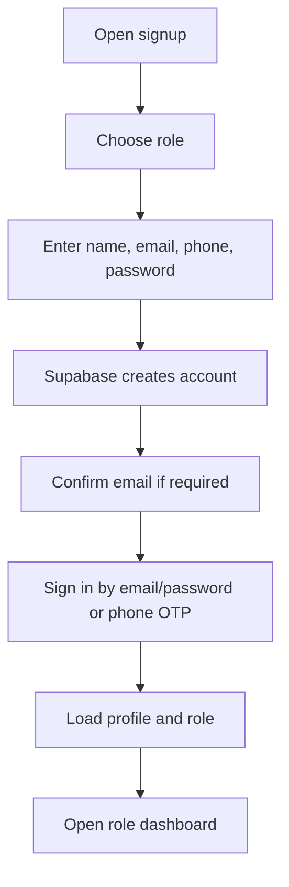
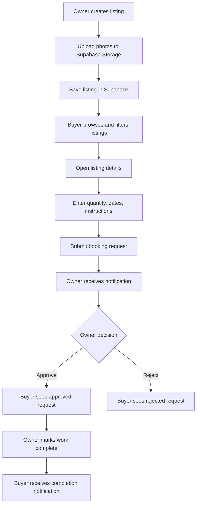
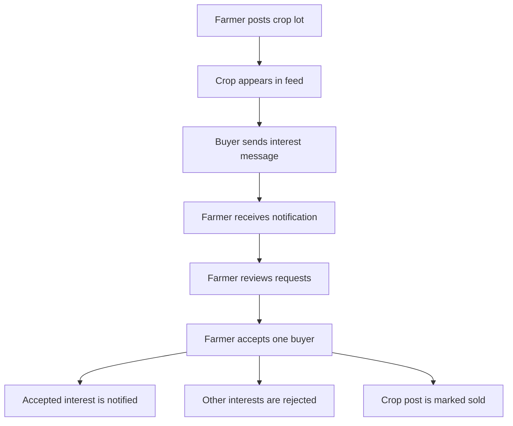
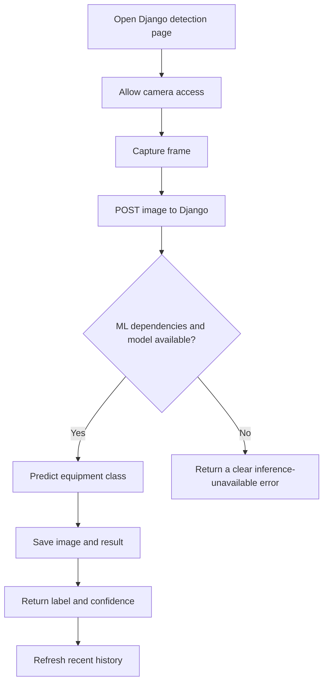

# AgriSmartX SDLC and Feature Book

This guide explains the AgriSmartX project in plain language for developers, testers, project reviewers, and anyone adding features. It describes the behavior present in the code today; it is not a claim that every planned marketplace capability is fully production-ready.

## 1. Project At A Glance

**AgriSmartX** is an agriculture platform where people can find farm resources, connect with sellers and workers, request bookings, and trade crops and agricultural products. It also includes a separate equipment-image recognition feature.

The project has three main parts:

| Part | What it does | Main technology |
| --- | --- | --- |
| Web application | Screens, navigation, roles, and user workflows | React 19, Vite, React Router |
| Marketplace data and accounts | Sign-in, database records, live updates, and image storage | Supabase Auth, Postgres, Realtime, Storage |
| Equipment detection | Camera page, model inference endpoint, and detection history | Django, OpenCV, NumPy, TensorFlow Lite |

Most marketplace operations run from the browser directly against Supabase. Django is currently used for equipment detection, not as the API server for listings, bookings, chat, or crop sales.

## 2. SDLC View

This section describes the software lifecycle represented by this repository. It is a practical guide to the product and code, not evidence that a formal approval process or a complete test suite already exists.

### 2.1 Discovery And Goals

The product addresses common farm-market needs:

- Find equipment, land, labor, and livestock in one place.
- Let people publish available resources and manage requests.
- Let farmers advertise harvest lots to bulk buyers.
- Let agricultural product sellers display their goods.
- Give users a way to communicate and track updates.
- Demonstrate equipment identification from a camera image.

### 2.2 Scope

Implemented areas include user registration and login, role-based dashboards, listings, booking requests, crop posts and interests, a product catalogue, notifications, messaging, profile editing, image uploads, and equipment recognition.

The current code does **not** show online payment processing, delivery management, a full administrator workflow for moderation, or a completed seller product-publishing and product-detail journey. Do not treat those as already implemented.

### 2.3 Requirements And Acceptance Summary

A feature is considered usable when the appropriate user can complete its main workflow, the record is saved in its intended data store, and the other participant can see or respond to it. The detailed flow and role sections below describe expected behavior. Supabase tables, policies, and storage buckets must be configured for these workflows to succeed.

### 2.4 Design And Architecture

The browser application owns page rendering and most marketplace business operations. Supabase is the external identity, database, realtime, and file service. Django is a separately deployed service for camera capture and model inference. The services are configured to deploy separately through Vercel and Render.

### 2.5 Implementation Map

- `frontend/src/App.jsx`: routes and authentication/role guards.
- `frontend/src/contexts/AuthContext.jsx`: session, profile, role, and sign-out state.
- `frontend/src/pages/`: user-facing pages and workflows.
- `frontend/src/pages/dashboards/`: role-specific dashboard experiences.
- `frontend/src/lib/`: Supabase operations for accounts, listings, bookings, crop sales, products, chat, notifications, reviews, and storage.
- `farm/views.py`: Django equipment detection and recent history views.
- `farm/models.py`: local Django detection history record.
- `agri/agri/settings.py`: Django settings and database configuration.
- `requirements.txt`: Python dependencies.
- `render.yaml`, `build.sh`: Render backend deployment configuration.
- `frontend/package.json`, `frontend/vercel.json`: web app commands and Vercel configuration.

### 2.6 Testing And Release

The repository has a Django test module stub, but no meaningful automated feature tests are currently defined there. Use the acceptance checklist in Section 10 before release. Run the frontend lint/build and Django checks/migrations as part of changes. Test Supabase-backed workflows against a configured project, since local Django checks cannot validate Supabase schemas or policies.

## 3. User Roles

| Role | What the user is here to do | Main dashboard areas |
| --- | --- | --- |
| Farmer | Find farm resources, book them, create permitted listings, and offer harvest lots | Overview, listings, crop sales, bookings, received requests, alerts |
| Labor | Advertise farm skills and availability, then respond to job requests | Overview, work profile, find work, job requests, alerts |
| Asset Owner | List equipment/livestock and handle incoming requests | Overview, assets, requests, earnings, alerts |
| Dealer / Seller | Manage inventory and respond to sales requests | Overview, inventory, sales, purchases, alerts |
| Buyer | Browse resources and products, and express interest in crop lots | Overview, browse, requests, crop feed, shop, alerts |

The code also recognizes legacy role values such as `equipment_owner` and `livestock_owner`. Signup currently presents the five roles in this table.

## 4. Feature Catalogue

### 4.1 Accounts And Access

- Signup starts by selecting a role, then collecting name, email, phone, and password.
- Email/password sign-in is supported.
- Phone OTP sign-in and verification are supported through Supabase Auth.
- Auth sessions persist in the browser; user profile details are read from the Supabase `users` table.
- Protected screens redirect signed-out users to login. Some actions/pages are restricted by role.
- The auth context includes a 30-minute offline auto-sign-out timer.
- Sign-out clears the Supabase session and returns to login.

### 4.2 Profile And Work Profile

- Users can edit their name, phone, city/village, state, and pincode.
- Users can upload a profile image to Supabase Storage.
- Profile UI displays role, rating/listing/booking counters, and verification state if those fields exist in profile data.
- Labor users can edit bio, skills, languages, experience, daily rate, availability, and travel radius.
- Labor users can toggle whether they are available for work.

### 4.3 Resource Listings

The listing types supported by the listing pages include:

- **Equipment:** model, manufacturer, year, horsepower, fuel, condition, usage, operator, and delivery details.
- **Land:** area, soil, water, irrigation, access, electricity, crop, and lease details.
- **Labor:** skills, experience, rates, languages, transport, and travel range.
- **Livestock:** animal type, breed, age, weight, health, and milk-yield details.
- **Product:** fields exist in listing code, but product catalogue behavior is also implemented separately using the `marketplace` table.

Users can filter available listings by type, location, and price; open a detail page; view photos and type-specific fields; and see listing views and owner information. Listing owners can manage their own listings; delete is implemented as a status change rather than a hard delete. Images are uploaded to Supabase Storage.

### 4.4 Booking And Requests

- From a listing detail page, a user can submit a request with quantity, optional dates, and special instructions.
- The estimated amount is calculated in the browser using the listing price, duration/quantity, and a 5% service charge.
- New requests start as `pending`; the owner receives a notification.
- Owners can approve or reject pending requests and mark approved requests completed.
- Buyers can see requests and cancel pending requests.
- Booking statuses used in code are `pending`, `approved`, `completed`, `cancelled`, and `rejected`.
- Buyer and owner dashboards can receive live booking updates through Supabase Realtime.

**Important:** the code creates booking requests and calculates a displayed fee, but does not implement payment collection or payment settlement.

### 4.5 Bulk Crop Sales

- A farmer posts a crop lot with title, crop type, quantity, unit, unit price, quality, optional harvest date, location, description, negotiation flag, and photos.
- Buyers browse and filter crop posts, then submit an optional message to express interest.
- The farmer reviews incoming interest and accepts one buyer.
- On acceptance, that buyer is marked accepted, other interests are rejected, and the crop post becomes sold.
- Notifications are sent for new interest and for acceptance/rejection outcomes.

Crop post statuses include `open` and `sold`; crop interest statuses include `pending`, `accepted`, and `rejected`.

### 4.6 Agricultural Product Catalogue

- The catalogue supports product categories such as seeds, fertilizers, pesticides, veterinary medicine, tools, feed, and other.
- Buyers can search by title and filter by category and price range.
- Product cards can show images, brand, price, original price/discount, rating, and stock state when supplied by the data.
- The product helper reads and creates records in the Supabase `marketplace` table.

**Current limitation:** the dealer listing form is wired to the `listings` table, while the product catalogue reads `marketplace`. A connected seller product-publishing journey is not clearly complete. The `/marketplace/:id` route currently renders the catalogue page, not a dedicated product detail screen.

### 4.7 Messaging

- Users can open a chat panel from a booking or use the `/chat` page.
- Each booking opens or reuses a row in `chats`; `messages.chat_id` references that room's UUID.
- Messages are stored in Supabase and loaded in time order, with live inserts delivered through Supabase Realtime.
- Chat messages include the sender name and message type; text messages use `message_type = 'text'`.
- Read state is updated for messages from the other participant.
- A new message creates a `message_received` notification for the other participant. The sender does not receive a notification for their own message.
- Recipients see a live popup and unread-count badge. The navigation-bar bell opens recent notifications; selecting a message notification marks it read and opens the chat.
- The `/chat` page accepts `booking_id`; message notification links may use `chat_id`. Legacy listing-based links resolve to the user's most recent booking for that listing.

### 4.8 Notifications

- The app fetches the user’s latest notifications and supports marking one or all as read.
- Booking and crop-interest helpers create notification records; a database trigger creates message notifications.
- Supabase Realtime drives notification popups, navigation-bar notification list updates, and unread-count updates.
- Clicking a notification marks it as read and navigates to its related chat when it contains a booking or chat ID; other notifications open the dashboard.
- Dashboard alert tabs display notification lists and unread counts.

### 4.9 Reviews

- The code can create a review containing listing, owner, booking, reviewer, rating, and comment details.
- Listing detail screens can display reviews for the listing.
- The repository does not show a complete user-facing review submission journey, so confirm that workflow before describing reviews as fully available to end users.

### 4.10 Equipment Image Detection

- Django serves a camera UI at `/farm/detect/`.
- The page can start/stop a browser camera, capture a frame, request one detection, or start repeated live detection.
- A compatible TFLite model is loaded from `farm_equipment_model.tflite` by default (or from `MODEL_PATH`).
- The classifier maps predictions to combine harvester, fertilizer spreader, harrow, seeder, tedder, and tractor.
- Captures and prediction details are saved in Django’s `DetectionHistory` model; the page can display recent captures from `/farm/history/`.

**Local platform note:** on Windows with Python 3.12, the standard `tflite-runtime` wheel is skipped. The Django page can still load, but image inference returns an unavailable-runtime error until a compatible inference runtime is provided. The Render deployment configuration targets Python 3.10 on Linux, where `tflite-runtime` is selected by the requirements marker.

## 5. Main User Flows

### 5.1 Signup And Sign-In



### 5.2 Create And Book A Resource



### 5.3 Bulk Crop Sale



### 5.4 Equipment Detection



## 6. Pages And Routes

| Route | Access | Purpose |
| --- | --- | --- |
| `/` | Public | Home page and featured marketplace content |
| `/signup` | Public | Role selection and account creation |
| `/login` | Public | Email/password or phone OTP login |
| `/listings` | Signed in | Browse/filter resource listings |
| `/listings/:id` | Signed in | Listing details and booking request |
| `/marketplace` | Signed in | Browse agricultural products |
| `/marketplace/:id` | Signed in | Currently resolves to the marketplace component; not a separate detail page |
| `/create-listing` | Signed in and role-checked | Create an allowed listing type |
| `/my-bookings` | Signed in and role-checked | View requests as buyer or owner |
| `/profile` | Signed in | Edit profile and avatar |
| `/dashboard` | Signed in and role-checked | Open role-specific dashboard |
| `/crop-sales` | Signed in | Browse crops or manage crop posts/interests |
| `/post-crop` | Farmer only | Create a bulk crop post |
| `/chat` | Signed in | Open a booking chat from `booking_id` or an authorized room from `chat_id` |
| `/farm/detect/` | Django endpoint | Camera capture and equipment detection page |
| `/farm/history/` | Django endpoint | Recent saved detections as JSON |

## 7. Data And External Services

The React app expects these Supabase tables:

| Table | What it stores |
| --- | --- |
| `users` | Application profile and role details |
| `listings` | Equipment, land, labor, livestock, and related listing fields |
| `bookings` | Buyer-to-owner booking/request records |
| `chats` | Chat rooms associated with a booking and its participants |
| `notifications` | Per-user alerts and read state |
| `marketplace` | Agricultural product catalogue records |
| `crop_posts` | Farmer bulk crop sale posts |
| `crop_interests` | Buyer interest in crop posts |
| `reviews` | Listing ratings and comments |
| `messages` | Chat-room messages, linked to `chats.id` |

The repository includes chat-specific migrations under `supabase/migrations/`. Apply the chat migrations in timestamp order: `20261030120000_fix_messages_rls_recursion.sql`, `20261030193000_align_chat_schema.sql`, `20261030194000_fix_chat_message_insert_rls.sql`, and `20261030195000_notify_chat_messages.sql`. They address recursive message policies, align rooms with the `chats` schema, authorize booking participants, and create recipient notifications when a message is inserted. The notification trigger requires the `notifications` table and its schema to match the notification fields it inserts. Deploy the matching frontend changes as well.

Supabase Realtime must include `messages` and `notifications` for live chat and alert updates. These migrations do not replace the rest of the project's database setup: verify all other table schemas, RLS policies, Realtime publication membership, and storage buckets in the Supabase project. Supabase Storage buckets are expected for listing and profile images (the code uses `listings` and `profiles`; crop photos use the default listing bucket).

Django uses its own database for detection history: SQLite by default locally, or PostgreSQL when `DATABASE_URL` is set. Uploaded detection images are stored under Django media storage. Confirm persistent media storage before relying on detection history in a redeployable production environment.

## 8. Run Locally

### 8.1 Prerequisites

- Node.js and npm for the frontend.
- Python 3.12 is supported for the current Windows local backend requirements.
- A Supabase project with the expected tables, policies, and storage buckets for marketplace features.
- For local equipment inference, a compatible TFLite runtime and the model file are also required. The detection page can load without inference dependencies.

### 8.2 Configure Frontend

Create `frontend/.env` using `frontend/.env.example` as a starting point:

```env
VITE_SUPABASE_URL=https://your-project.supabase.co
VITE_SUPABASE_ANON_KEY=your-supabase-anon-key
VITE_BACKEND_URL=http://127.0.0.1:8000
```

Use the Supabase anon/public key in the browser application, never a Supabase service-role key.

### 8.3 Install And Run The Django Backend

From the repository root, install the regular Python requirements into the selected Python installation (no virtual environment is required):

```powershell
py -m pip install -r requirements.txt
```

Then start Django:

```powershell
cd .\agri
py manage.py migrate
py manage.py check
py manage.py runserver 8000
```

The backend page is at `http://127.0.0.1:8000/farm/detect/`. The history endpoint is at `http://127.0.0.1:8000/farm/history/`.

### 8.4 Install And Run The Frontend

In a second terminal:

```powershell
cd "F:\VS Code Languages\My Tutorials\Projects\Agri\frontend"
npm install
npm run dev
```

Open `http://localhost:5173`. Keep Django running on port 8000 if you want the frontend camera modal to load the local detection page.

### 8.5 Useful Checks

```powershell
# From repository root
py -m pip install -r requirements.txt

# From Agri\agri
py manage.py check
py manage.py migrate

# From Agri\frontend
npm run lint
npm run build
```

The Python requirements use platform/version markers: local Windows Python 3.12 skips `tflite-runtime`; Linux Python 3.10, as configured for Render, selects it. If Windows installation or inference behavior differs, check the active interpreter with `py --version` and package state with `py -m pip show numpy Django`.

## 9. Deployment Overview

### Frontend: Vercel

The Vercel configuration builds the app from `frontend/` and serves the generated `frontend/dist` files. Add `VITE_SUPABASE_URL`, `VITE_SUPABASE_ANON_KEY`, and the deployed Django URL as `VITE_BACKEND_URL` in Vercel environment variables. Configure the production Supabase URL and any required auth redirect URLs in Supabase.

### Backend: Render

The root `render.yaml` configures a Python web service. `build.sh` installs `requirements.txt`, runs Django `collectstatic`, and applies migrations. The service starts Gunicorn from the `agri` directory. Configure production `SECRET_KEY`, `DEBUG=False`, host allow-list, `CORS_ALLOWED_ORIGINS`, and database settings. The configured Render Python version is 3.10.0, which matches the TFLite dependency marker.

### Deployment Readiness Notes

- Keep frontend and backend environment variables aligned with the real deployed domains.
- Keep secrets in hosting environment settings, not committed files.
- Set Supabase RLS policies so each role can only access permitted records.
- The Django detection endpoint currently accepts image POSTs without application-level authentication; review abuse controls and upload limits before exposing it publicly.
- Django development media serving is enabled only when `DEBUG=True`; configure durable media storage and serving for production history images.
- Ensure the model file is included in the backend deployment and that `MODEL_PATH` points to it if it is stored elsewhere.
- Vercel's rewrite configuration serves the React app fallback. The Django `/farm/...` routes belong to the Render backend, not Vercel.

## 10. Quality And Acceptance Checklist

Use this checklist for manual testing after feature work:

- A new user can choose each offered role and complete signup, including required email confirmation behavior.
- Email login and phone OTP login work with the configured Supabase project.
- Signed-out users are redirected from private routes, and role restrictions behave as intended.
- Profile changes and avatar uploads persist after refreshing.
- Listings can be created, found by filters, opened, and soft-deleted by their owner.
- A buyer can submit a booking; the owner can approve/reject it; both sides see the updated state and notifications.
- A farmer can post a crop; a buyer can express interest; the farmer can accept one request; sold and rejected states are visible.
- Product catalogue search/category/price filters return expected records.
- Chat messages persist, appear live to the other participant, and update read state.
- Notification counts and read/unread actions match the notification table.
- Django check and migrations succeed; the detection page renders; with compatible model runtime installed, an image produces a label and appears in history.
- `npm run lint` and `npm run build` complete without errors.

## 11. Known Gaps And Follow-Up Work

These are visible from the current repository and should be resolved or explicitly accepted before calling the product complete:

1. **Product selling path:** connect dealer product creation to the `marketplace` table and provide a distinct product detail and purchase/request flow.
2. **Reviews:** provide a clear eligible-user review submission flow and enforce one review per completed booking if that is the intended rule.
3. **Payments:** implement and test payment provider integration if the 5% service fee is meant to be collected, not merely estimated.
4. **Supabase setup:** version-control a safe schema/migration process and document table columns, RLS policies, buckets, and Realtime requirements.
5. **Testing:** add automated tests for core Supabase workflows and Django detection behavior, including missing-runtime/model errors.
6. **Production detection:** add access controls, upload size/type validation, request throttling, and persistent image storage.
7. **Role consistency:** reconcile current role names with legacy aliases across signup, profile display, listing permissions, and dashboards.
8. **Frontend routes:** implement a real product detail view or remove/redirect `/marketplace/:id` until one exists.
9. **Documentation alignment:** `frontend/PROJECT_DOCUMENTATION.md` predates the Django backend and should be updated or treated as frontend-only notes.

## 12. Glossary

- **Listing:** A resource or service offered on the platform, such as equipment, land, labor, or livestock.
- **Booking/request:** A buyer’s request to rent or purchase a listing, pending the owner’s response.
- **Crop post:** A farmer’s bulk harvest offer.
- **Crop interest:** A buyer’s message indicating interest in a crop post.
- **Realtime:** Supabase’s live event updates used for bookings, messages, and notifications.
- **RLS:** Supabase Row Level Security; database rules that control which users can read or change each row.
- **TFLite:** TensorFlow Lite, the runtime format used by the equipment classification model.
